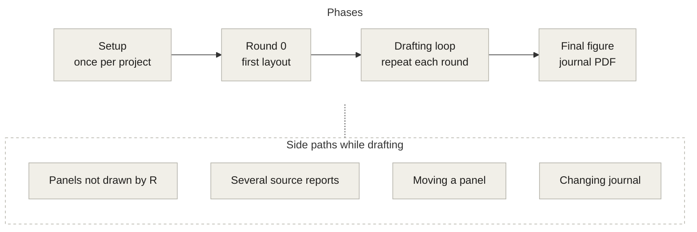
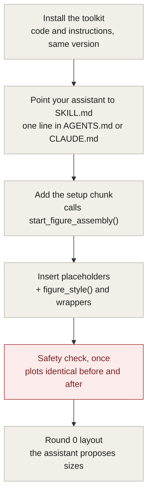
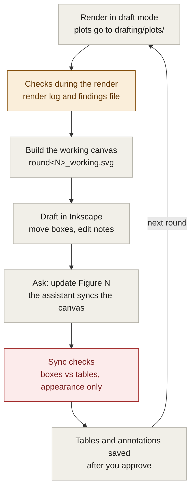
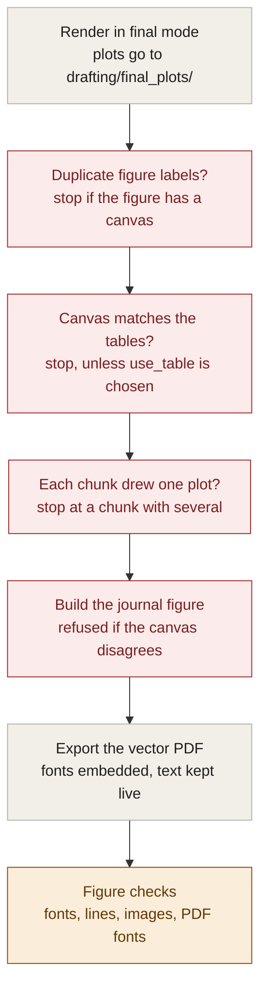
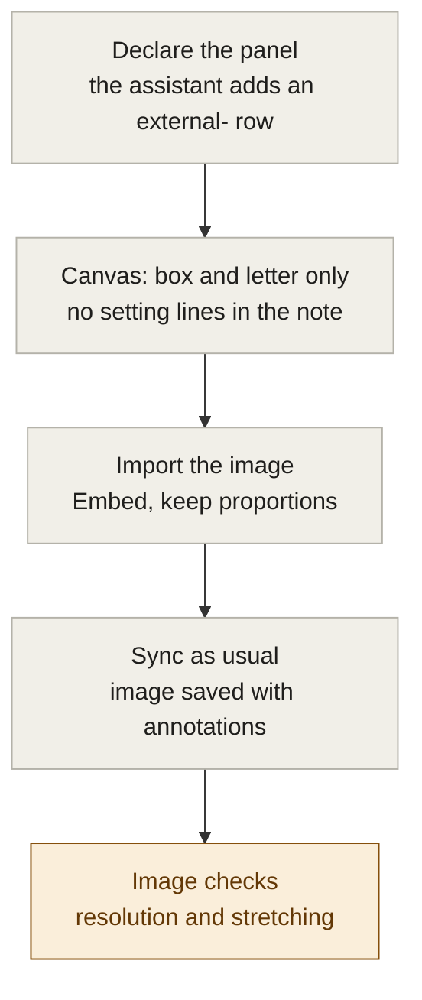
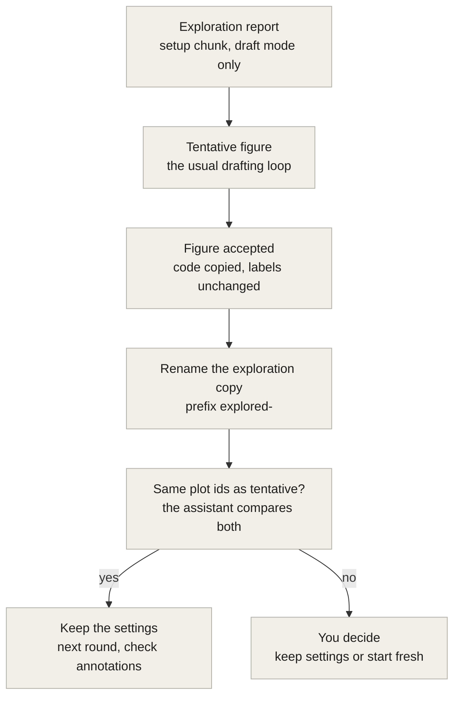
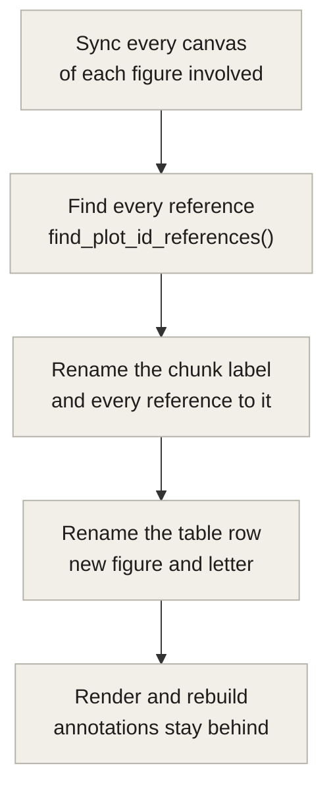
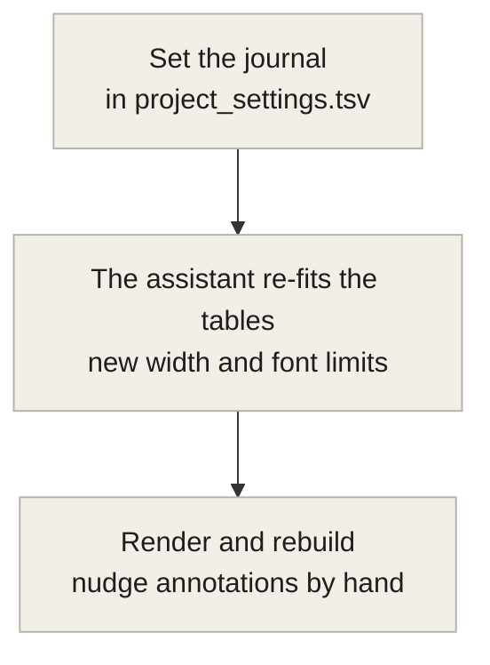

# Protocol flow charts

An overview of `PROTOCOL.md` and `SKILL.md`. `PROTOCOL.md` is the reference: where the two disagree, it is right. These charts are not kept in sync with the protocol automatically; they match it as of commit 1cb6ae3 (toolkit 0.1.0).

Colours: grey is a step, red is a check that can stop the work, amber is a check that only reports.

## 1. Overview

Four phases. The side paths can happen at any time while drafting.

## 2. Setup and round 0

Once per paper project. You run the safety check by hand.

## 3. Drafting loop

Repeats once per round. Checks during a draft render never stop it. Before syncing, the assistant reads the findings files in `drafting/project_checks/` (one per report) and runs `check_project()`. Positions and sizes come only from the boxes: a plot moved or resized on the canvas itself is reported and ignored.

## 4. Final figure

The three render-time stops apply only to figures that have a working canvas, and each stop is recorded in the figures document's findings file in `drafting/project_checks/`. The journal build also refuses to run while canvas and tables disagree.

## 5. Safety checks in one place

"Enforced by" matters for public users: a rule enforced by the assistant holds only when an assistant has read `figure_assembly/SKILL.md`, and disappears when someone works without one.

| Check | Enforced by | When it runs | What happens on a problem |
|---|---|---|---|
| Before/after identity check | You, by hand | Once, at setup | You investigate before continuing. A plot that uses random numbers (Euler layouts, jitter, repelled labels, subsampling) differs between renders unless it is seeded. |
| Project checks: duplicate labels, multi-plot chunks, leftover rows, report-wide `fig.path`, stale plot files | Code | Start of every render; `check_project()` at any time | Draft: written to the render log and the report's findings file in `drafting/project_checks/`. Final: stops on a duplicate label in a figure with a canvas. |
| Plot count per chunk | Code (knitr hook) | After each figure chunk | Draft: render log and the report's findings file only. Final: stops at that chunk if its figure has a canvas. |
| Box-note parsing | Code | Each sync | Known setting names are applied exactly; unreadable values are reported as "NOT applied". |
| Appearance-only rule | Assistant | Each sync, for free-text notes | Refuses analysis changes and flags wording that contains values computed from the data. |
| Canvas vs tables | Code | Each sync, start of a final render, journal build | Positions and sizes come only from the boxes; a plot moved on the canvas itself is reported and ignored. The final render stops unless you choose `use_table`; the journal build is refused. The final-render result is recorded in the figures document's findings file. |
| `check_figure_svg()` | Code | After each build, and at the end | Reports font sizes, line widths, fonts, flowed text, linked images, image dpi, stretching and page size. |
| `check_pdf_fonts()` | Code | After the PDF export | Reports text turned into outlines and fonts that are not embedded. |

## 6. Panels not drawn by R

Micrographs, blots, deepTools PDFs and schematics. Their table rows never count as leftovers.

## 7. Several source reports: tentative to final

Exploration reports feed tentative figures; final figures always come from the figures document. At the last step, the assistant asks you instead of deciding when the plots changed.

## 8. Moving a panel, and changing journal

Two short side paths. Renaming a cached chunk discards its cache, so the next render recomputes it.

### Moving a panel

### Changing journal

